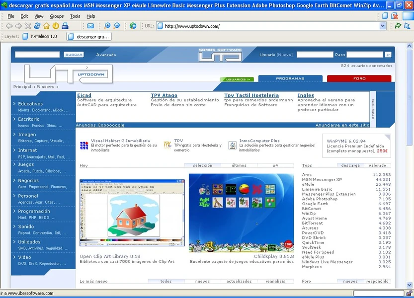

# K-Meleon Customizable Windows Browsing and Profile Control

[](https://github.com/k-meleon-web-browser/k-meleon/releases/)

K-Meleon combines a native Windows browser interface with extensive configuration options.
Use k meleon when your workflow calls for direct control over profiles, menus, toolbars and browser behavior.

The k-meleon browser has an official Gecko-based release line and a separate community-maintained Goanna branch.
This guide uses official stable K-Meleon 75.1 as its release reference.

## Browser Layout and Daily Use

A useful browser layout keeps frequent actions visible without filling the window with controls.
K-Meleon supports customization through preferences, configuration files, macros and plugins.

- Keep commonly used navigation actions easy to reach.
- Organize bookmarks around the pages you revisit.
- Use separate profiles for configurations with different purposes.
- Change one preference at a time when investigating behavior.
- Record the exact browser build when reporting a problem.

The k meleon web browser can be adapted to a focused browsing routine.
Its interface customization and its rendering engine are separate parts of that experience.



## System Requirements

### Documented Baseline

The official K-Meleon 75 release notes describe a historical Windows XP SP2 baseline.
They recommend at least 256 MB of RAM and list approximately 70 MB for a full installation.

Those figures describe the application of that period.
They do not predict the memory or processing power required by a present-day website.

No fixed processor recommendation is supplied here.
Processor and operating-system requirements should be checked against the exact package you intend to use.

### Recommended Workload Check

Evaluate the pages and tasks that matter to you rather than relying on the application's download size.
A small browser interface can still display a demanding document.

- Open a representative page before configuring a large session.
- Compare one-tab and several-tab memory use.
- Check scrolling, text entry and downloads separately.
- Test the media features your workflow actually needs.
- Record failures with the page and build details needed to reproduce them.

### Operating System Scope

K-Meleon is a Windows application.
Compatibility details from one release or community build do not automatically apply to another.

The official stable 75.1 packages and Goanna community packages belong to different release paths.
Select the package before deciding which runtime requirements apply.

## Choosing a Package

| Package or component | Purpose | What to confirm |
| --- | --- | --- |
| Official 75.1 installer | Conventional Windows deployment | Application location and profile choice |
| Official 75.1 archive | Extracted application files | Profile location and write permissions |
| Community Goanna build | An independently maintained browser branch | Maintainer, build date and engine version |
| Existing profile | Preferences and personal browser data | Compatibility with the destination build |
| Macro or plugin | Additional behavior | The release and interfaces it was written for |

The stable installer and archive are alternative distributions of the official release.
An archive alone does not establish where personal data will be stored.

## Command-Line Profiles

K-Meleon accepts profile selection and new-instance options.
The following PowerShell examples assume the current directory contains the browser executable.

```powershell
.\k-meleon.exe "about:blank"
.\k-meleon.exe -P "Reading"
.\k-meleon.exe -new -P "Testing"
```

Reading and Testing are example names for profiles you have already created.
The profile option uses an uppercase P.

Use a new instance when you need a second profile active at the same time.
Do not open the same profile in multiple instances.

## Portable or Custom Profile Location

The k-meleon portable workflow depends on an explicit profile-location choice.
K-Meleon documents an application-level profile.ini file for selecting that location.

Place the following configuration beside the browser executable when a relative profile directory is intended.

```ini
[profile]
path=Profiles
isRelative=1
```

The directory name is resolved relative to the K-Meleon application directory.
Choose a location where the current Windows user can write profile data.

The application-level profile.ini is different from the profile registry named profiles.ini.
Keep that distinction in mind when diagnosing an unexpected profile location.

## Moving a Profile

Find the active profile through Edit, Configuration, Profile Directory.
Confirm the actual directory before copying personal browser data.

Close the browser before taking a manual copy.
Keep the original until the copied profile has been checked in the intended environment.

A useful move verification includes:

- Confirming that expected bookmarks are present.
- Checking the selected homepage and other visible preferences.
- Reviewing saved sessions before opening a large group of pages.
- Confirming that custom menus or macros are still available.
- Checking that the profile directory remains writable.

Profile selection problems and webpage rendering problems require different investigations.
First establish that the browser loaded the profile you expected.


## Menus, Toolbars and Macros

K-Meleon exposes much of its behavior through configurable interface elements.
Macros provide a browser-specific way to connect actions and extend a workflow.

Start with a single adjustment whose result is easy to observe.
For example, simplify a toolbar before attempting a larger menu reorganization.

Keep a description of each customization beside your backup notes.
That makes it easier to identify an extension that stopped working after a build change.

Treat macros and plugins as version-dependent components.
A configuration written for an older interface may need adjustment before it fits another branch.

## Building from Source

Building K-Meleon involves the Windows browser shell, its plugins and a matching engine environment.
A complete distribution requires more than compiling one executable.

The project's older build guide describes Visual C++ and Mozilla development components.
Parts of that guide explicitly target much older K-Meleon source revisions.

Use instructions associated with the exact source branch being built.
A modern compiler name alone is not enough to establish compatibility with an older engine SDK.

Before attempting a build, identify:

- The browser-shell revision.
- The matching Gecko or Goanna engine source.
- The compiler and Windows SDK expected by that revision.
- Required libraries and plugin projects.
- The files needed to assemble a runnable distribution.

This guide does not prescribe a universal build command.
The historical documentation does not establish one current recipe for every maintained branch.

## Release Identification

The k-meleon open source browser has several version labels that may appear in downloads or forum discussions.
Keep the application version, engine version and community build date separate.

Official stable K-Meleon 75.1 uses Gecko 31.8.
A community package carrying a higher browser version is not the same artifact as the official stable installer.

When comparing behavior, record the complete package identity.
Include whether the browser came from the official stable files or a named community maintainer.

## Compatibility Review

Application startup is only one part of browser compatibility.
A page can load its text while a particular script, media format or account flow fails.

When a page behaves unexpectedly, check a small reproducible sequence.
Describe the visible result rather than assuming that every failure has the same cause.

- Compare the behavior with a clean test profile.
- Review relevant preferences and custom extensions.
- Note the page action that triggers the failure.
- Record whether the problem affects one page or several.

Keep release selection separate from claims about support for current websites.
For an old stable build, evaluate the actual page requirements before depending on it for a workflow.

## Related Search Terms

k meleon, k-meleon browser, k meleon web browser, k-meleon portable, k-meleon open source browser, web-browser, webbrowser, windows, browser, gecko, goanna, win32, open-source
